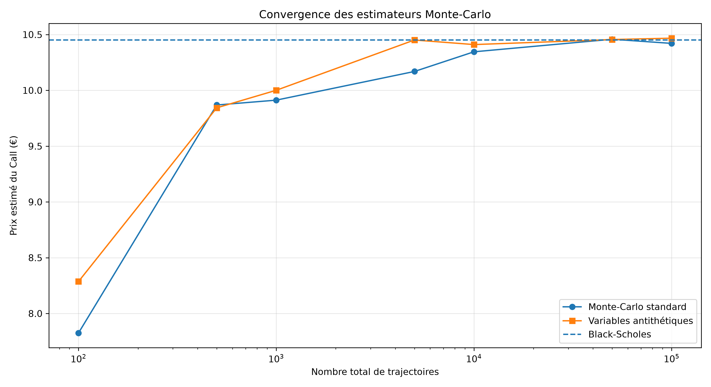
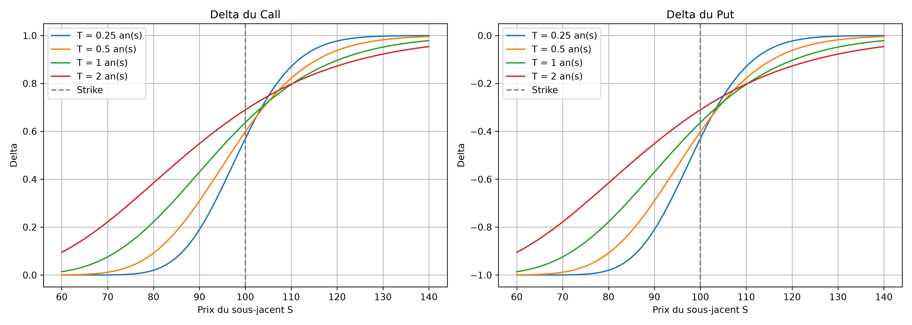
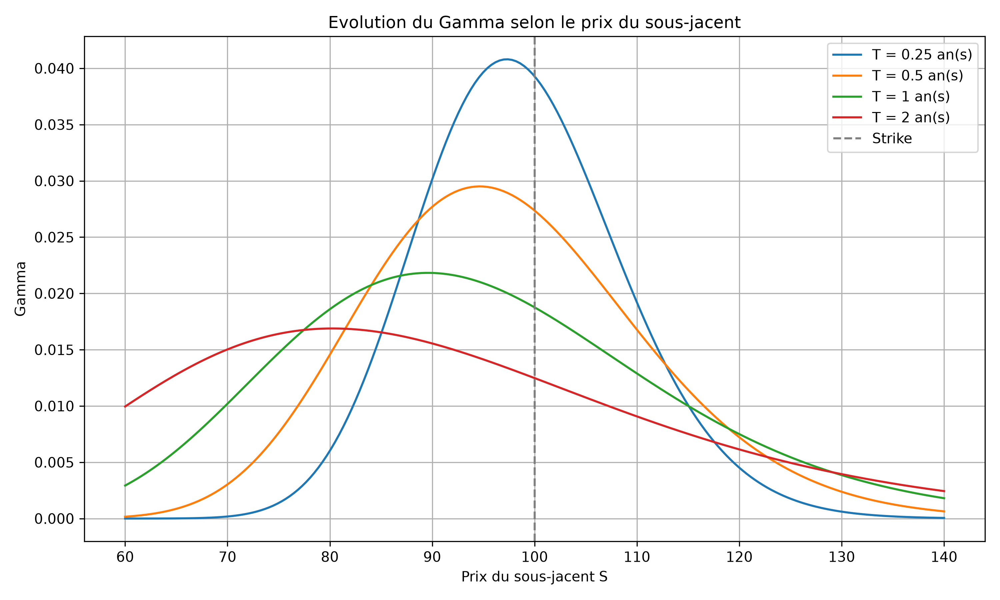
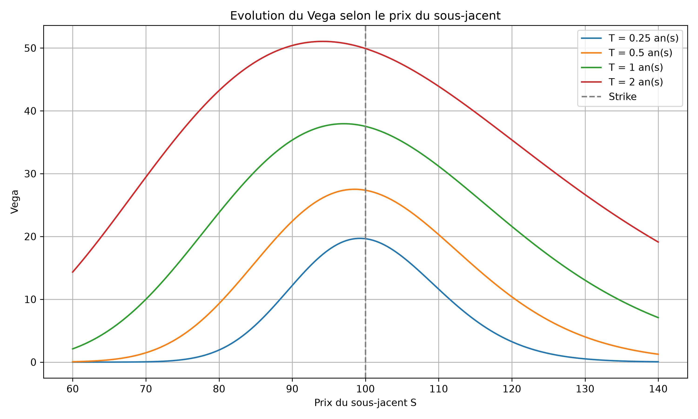
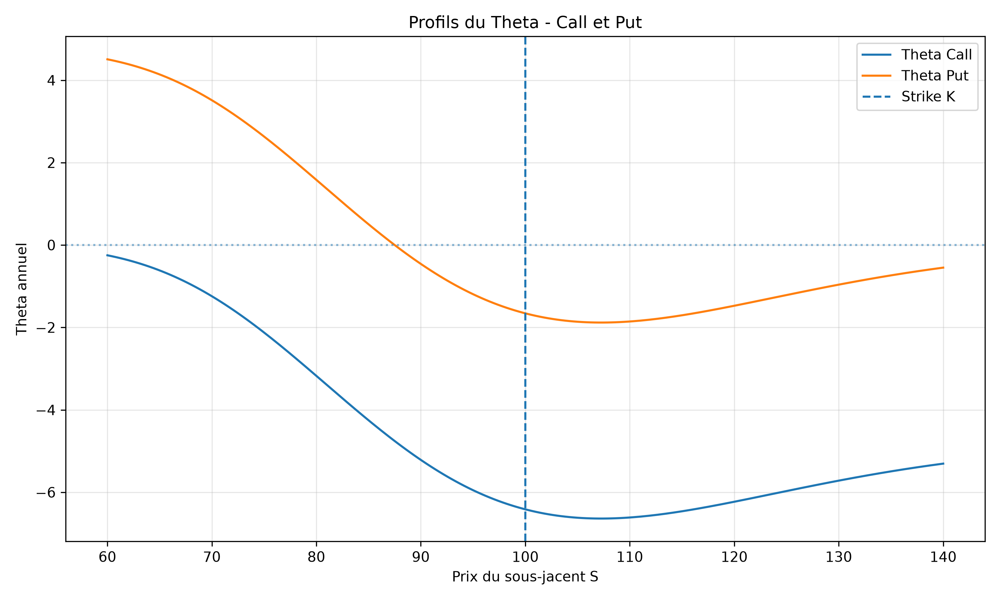
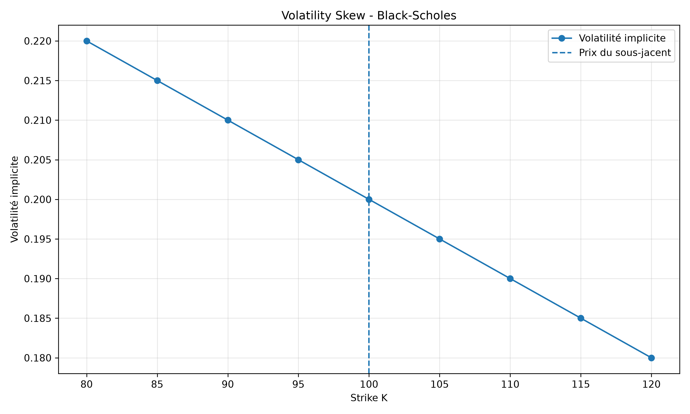
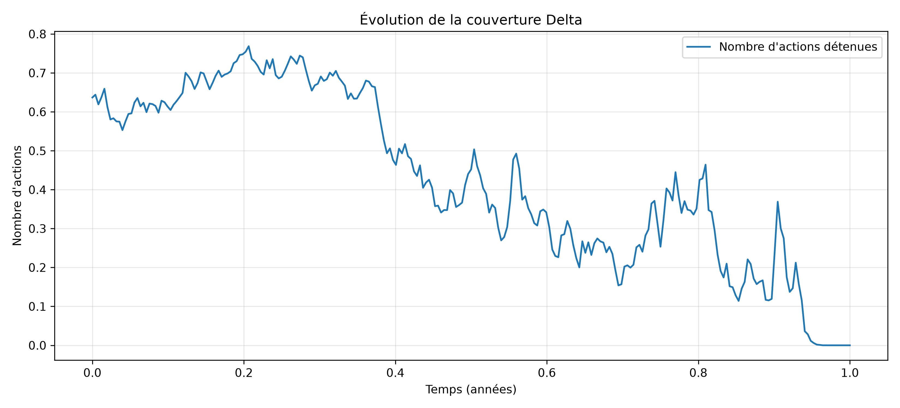
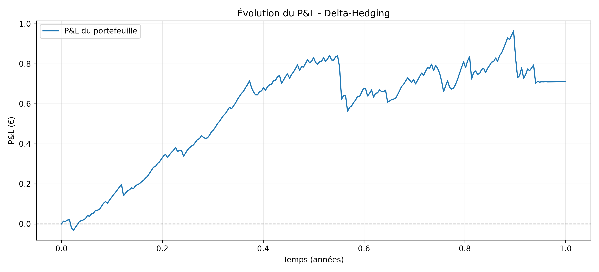

# Options Pricing & Delta Hedging

A Python-based quantitative finance project focused on European option pricing, Monte Carlo simulation, option Greeks, implied volatility estimation, and dynamic delta hedging.

## 1. Project Overview

This project implements and analyzes several quantitative methods used in derivatives pricing and risk management.

The main objective is to understand how financial options are valued, how their sensitivities to market parameters are measured, and how dynamic hedging strategies can be implemented and evaluated.

The project combines mathematical models, numerical methods, Python programming, and financial analysis.

## 2. Project Objectives

The project is organized into four main modules:

### Module 1 — Option Pricing

- European Call and Put pricing using the Black-Scholes model.
- Monte Carlo pricing simulation.
- Variance reduction using antithetic variates.
- Asian option pricing through Monte Carlo simulation.

### Module 2 — Option Greeks

Calculation and analysis of the main option sensitivities:

- Delta
- Gamma
- Vega
- Theta
- Rho

The project also compares analytical Greeks with numerical approximations based on finite differences.

### Module 3 — Implied Volatility

- Implied volatility estimation using the Newton-Raphson algorithm.
- Use of Vega in the numerical optimization procedure.
- Application to real market option-chain data.
- Analysis of the limitations of the Black-Scholes model when applied to market-traded options.

### Module 4 — Delta Hedging

- Simulation of the underlying asset using Geometric Brownian Motion.
- Dynamic hedging of a short European Call position.
- Daily portfolio rebalancing.
- Analysis of the evolution of Delta and hedge positions.
- Evaluation of the hedging portfolio's Profit and Loss (P&L).

## 3. Project Structure

```text
options-pricer-delta-hedging/
│
├── README.md
├── requirements.txt
│
├── src/
│   ├── __init__.py
│   ├── pricing.py
│   ├── greeks.py
│   ├── volatility.py
│   └── hedging.py
│
├── tests/
│   ├── test_volatility.py
│   └── test_hedging.py
│
├── figures/
│   ├── aapl_calls_comparison.png
│   ├── aapl_puts_comparison.png
│   ├── delta_maturities.png
│   ├── gamma_maturities.png
│   ├── vega_maturities.png
│   ├── gbm_simulation.png
│   ├── delta_hedging_positions.png
│   └── delta_hedging_pnl.png
│
└── notebooks/
    └── analysis.ipynb
```

## 4. Mathematical Models and Numerical Methods

The project relies on several fundamental quantitative finance techniques:

- Black-Scholes analytical pricing model.
- Geometric Brownian Motion (GBM).
- Monte Carlo simulation.
- Antithetic variates.
- Finite difference methods.
- Newton-Raphson algorithm.
- Dynamic Delta Hedging.

## 5. Technologies and Libraries

- **Python** — Main programming language.
- **NumPy** — Numerical computations.
- **Pandas** — Data manipulation and analysis.
- **Matplotlib** — Data visualization.
- **SciPy** — Statistical functions and numerical methods.
- **yfinance** — Financial market data retrieval.
- **Jupyter Notebook** — Interactive analysis and experimentation.
- **unittest** — Unit testing.

## 6. Visual Results

The following figures are generated by the analysis notebook and stored in the `figures/` directory.

### 6.1 Option Pricing — Market Data Comparison

Comparison of the model-based analysis for Apple (AAPL) call and put options.

<p align="center">
  
</p>

<p align="center">
  
</p>

### 6.2 Monte Carlo Simulation

Illustration of Monte Carlo convergence and the simulated underlying-price dynamics.

<p align="center">
  
</p>

<p align="center">
  
</p>

### 6.3 Option Greeks — Sensitivity to Maturity

The following plots illustrate how selected option sensitivities vary with the underlying price for different maturities.

<p align="center">
  
</p>

<p align="center">
  
</p>

<p align="center">
  
</p>

Additional Greek profiles:

<p align="center">
  
</p>

<p align="center">
  
</p>

<p align="center">
  
</p>

<p align="center">
  
</p>

<p align="center">
  
</p>

### 6.4 Implied Volatility

Illustrations of the volatility smile and skew obtained from the option-chain analysis.

<p align="center">
  
</p>

<p align="center">
  
</p>

### 6.5 Delta Hedging

The hedging figures show the evolution of the underlying hedge position and the resulting portfolio P&L during the simulated hedging strategy.

<p align="center">
  
</p>

<p align="center">
  
</p>

## 7. Installation

Clone the repository:

```bash
git clone https://github.com/mamethiernot099-wq/options-pricer-delta-hedging.git
cd options-pricer-delta-hedging
```

Create a virtual environment:

```bash
python -m venv .venv
```

Activate the environment.

Windows:

```bash
.venv\Scripts\activate
```

Install dependencies:

```bash
pip install -r requirements.txt
```

## 8. Run the Project

Open the Jupyter Notebook:

```bash
jupyter notebook notebooks/analysis.ipynb
```

The notebook contains the numerical experiments, simulations, visualizations, and financial analysis.

## 9. Run Tests

Execute the unit tests with:

```bash
python -m unittest discover -s tests -v
```

## 10. Current Scope and Future Improvements

The project is being developed progressively.

Potential extensions include:

- Volatility smile and skew analysis.
- Delta hedging using historical market data.
- Comparison of daily, weekly, and monthly rebalancing frequencies.
- Transaction costs and their impact on hedging performance.
- Hedging error analysis under different market conditions.
- Further extensions to option pricing and risk management models.

## 11. Disclaimer

This project is developed for educational and quantitative research purposes. The models and simulations presented are simplified representations of financial markets and should not be considered investment advice.

---

**Author:** [Mame Thierno THIAM]  
**Field:** Mathematical Finance | Quantitative Finance | Risk Management
