# Options Pricer & Delta Hedging

**Projet de finance quantitative en Python** — valorisation d'options, simulation Monte-Carlo, sensibilités (Greeks), volatilité implicite et couverture dynamique Delta.

Ce dépôt rassemble des outils de calcul réutilisables dans `src/`, des tests automatisés dans `tests/` et une étude numérique complète dans le notebook `notebooks/analysis.ipynb`.

---

## Sommaire

- [Objectifs](#-objectifs)
- [Contenu du projet](#-contenu-du-projet)
- [Résultats et visualisations](#-résultats-et-visualisations)
- [Modèle et hypothèses](#-modèle-et-hypothèses)
- [Installation](#-installation)
- [Exécuter le notebook](#-exécuter-le-notebook)
- [Lancer les tests](#-lancer-les-tests)
- [Limites et pistes d'amélioration](#-limites-et-pistes-damélioration)

## Objectifs

Le projet a pour objectifs de :

- valoriser des options européennes avec le modèle de Black-Scholes et des méthodes de Monte-Carlo ;
- étudier la réduction de variance par variables antithétiques ;
- valoriser une option asiatique à moyenne arithmétique ;
- calculer les principales sensibilités d'une option (Delta, Gamma, Vega, Theta et Rho) ;
- retrouver la volatilité implicite à partir d'un prix d'option ;
- confronter les calculs à une chaîne d'options réelle sur **AAPL** ;
- simuler une couverture Delta et analyser l'effet de la fréquence de rebalancement et des coûts de transaction.

## Contenu du projet

Le notebook suit six parties progressives :

| Partie | Contenu |
|---|---|
| 1. Pricing européen | Black-Scholes, Monte-Carlo, intervalle de confiance et variables antithétiques |
| 2. Option asiatique | Simulation Monte-Carlo d'un Call asiatique à moyenne arithmétique |
| 3. Grecques | Calcul des sensibilités et comparaison avec les différences finies |
| 4. Volatilité implicite | Résolution numérique et validation sur des cas synthétiques |
| 5. Données AAPL | Analyse d'une chaîne d'options et comparaison des volatilités implicites |
| 6. Delta Hedging | Simulation GBM, fréquences de couverture, coûts et distribution du P&L |

### Architecture

```text
options-pricer-delta-hedging/
├── README.md
├── requirements.txt
├── src/
│   ├── pricing.py
│   ├── greeks.py
│   ├── volatility.py
│   └── hedging.py
├── tests/
│   ├── test_pricing.py
│   ├── test_greeks.py
│   ├── test_volatility.py
│   └── test_hedging.py
├── notebooks/
│   └── analysis.ipynb
└── figures/
    └── graphiques générés par le notebook
```

- **`src/`** : fonctions de pricing, de calcul des Grecques, de volatilité implicite et de couverture.
- **`tests/`** : tests unitaires des modules Python.
- **`notebooks/analysis.ipynb`** : expériences, visualisations et interprétation financière.
- **`figures/`** : graphiques exportés par le notebook.

## Résultats et visualisations

Les figures ci-dessous sont enregistrées dans `figures/`. Elles sont également régénérées lors de l'exécution des cellules correspondantes du notebook.

### Convergence Monte-Carlo


### Sensibilités — Greeks

| Delta | Gamma |
|---|---|
| 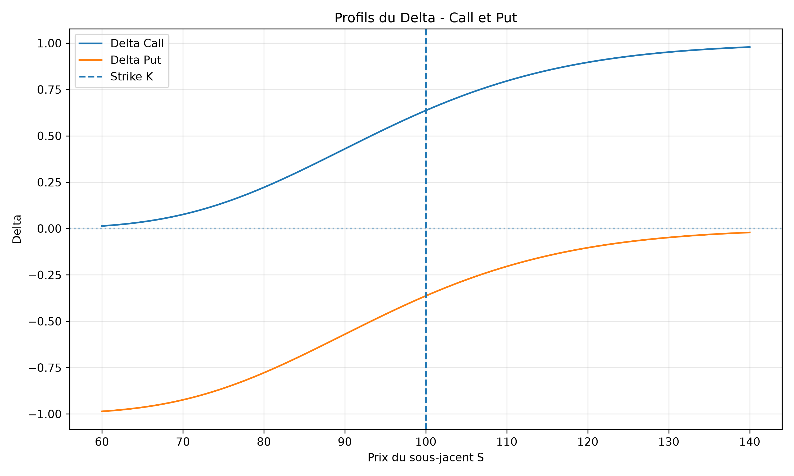 | 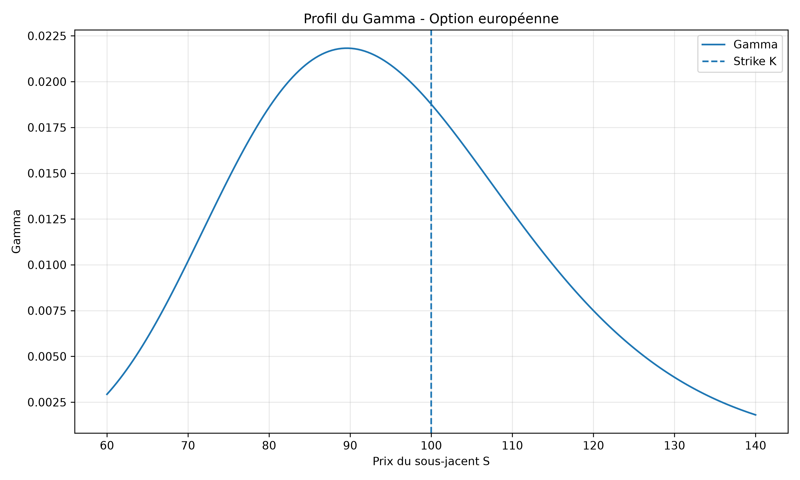 |

| Vega | Theta |
|---|---|
| 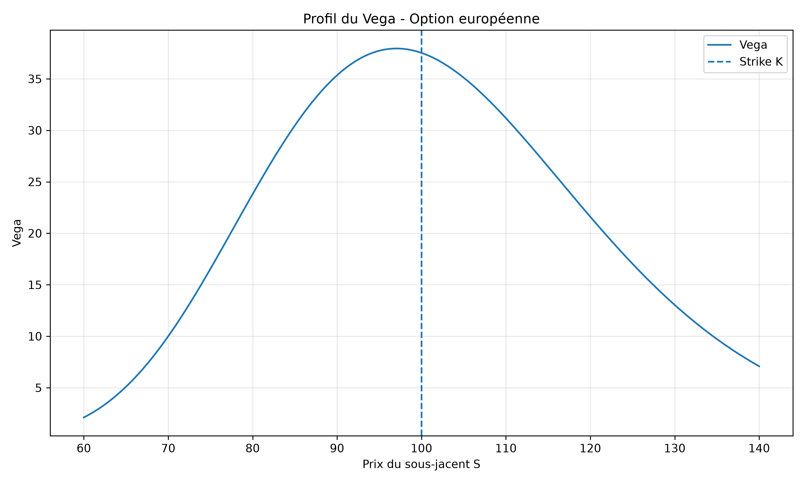 |  |

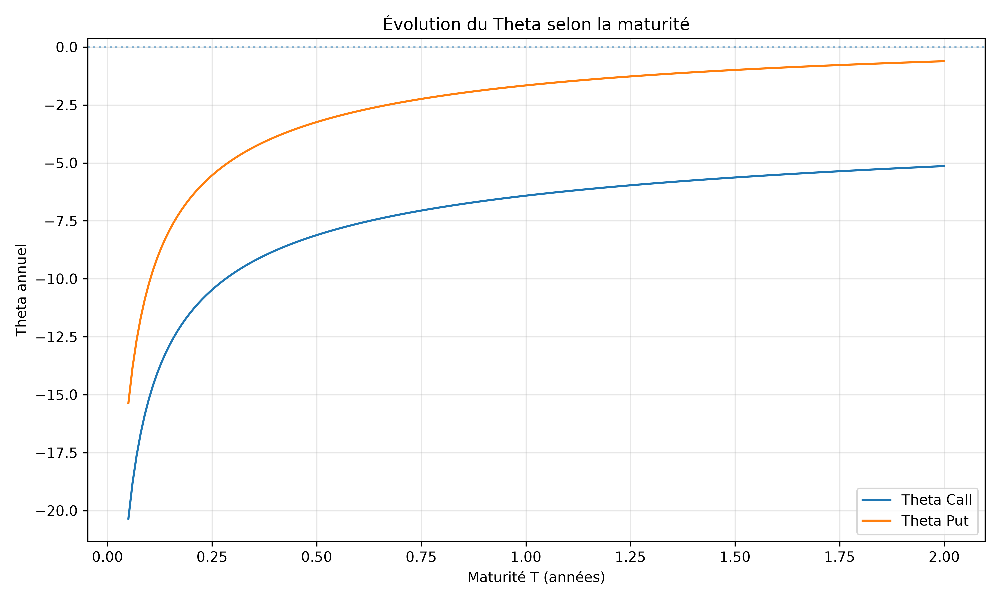

### Volatilité implicite et données AAPL

| Smile de volatilité | Skew de volatilité |
|---|---|
| 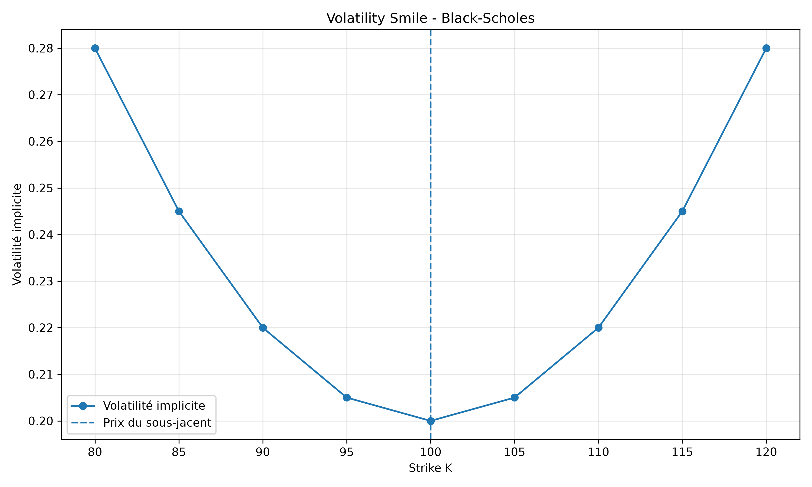 |  |

| Calls AAPL | Puts AAPL |
|---|---|
| 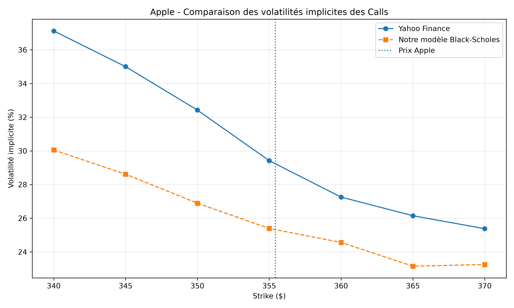 | 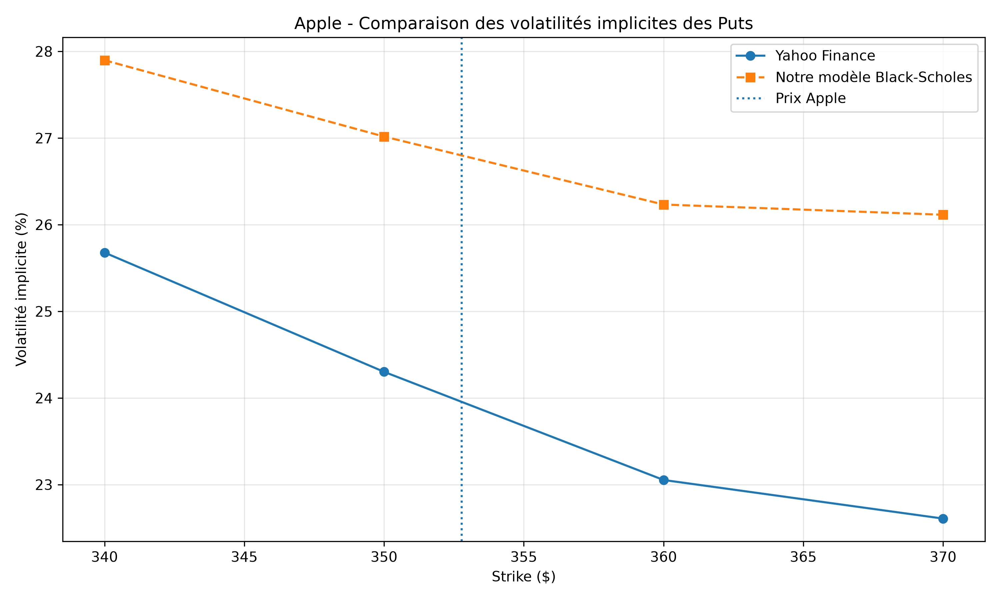 |

### Delta Hedging

La couverture est comparée sur une trajectoire commune pour trois fréquences : quotidienne (**Daily**), hebdomadaire (**Weekly**, tous les 5 pas) et mensuelle (**Monthly**, tous les 21 pas).

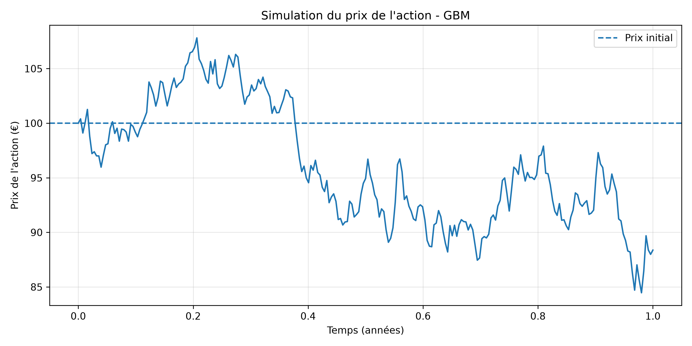

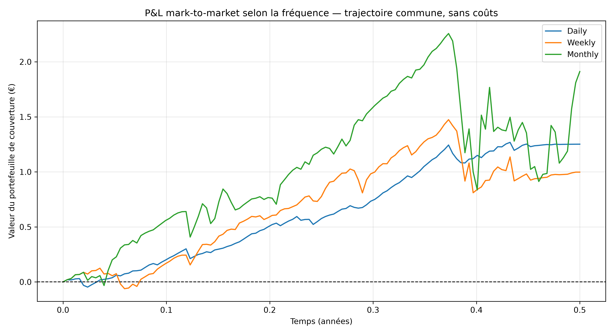

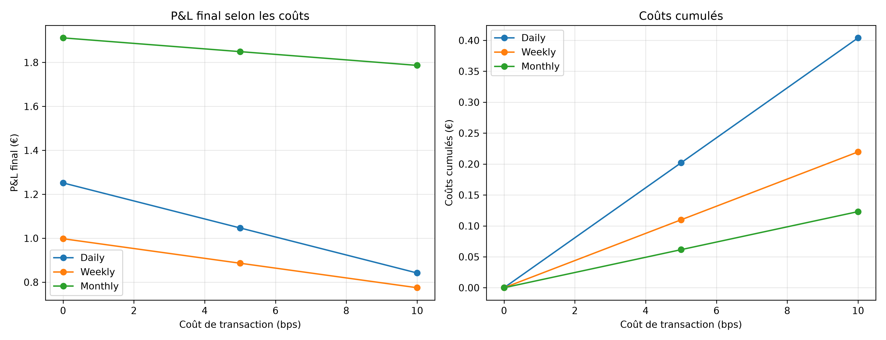

Une étude Monte-Carlo complémentaire répète la couverture sur **300 trajectoires** afin d'étudier la distribution du P&L terminal selon la fréquence de rebalancement.

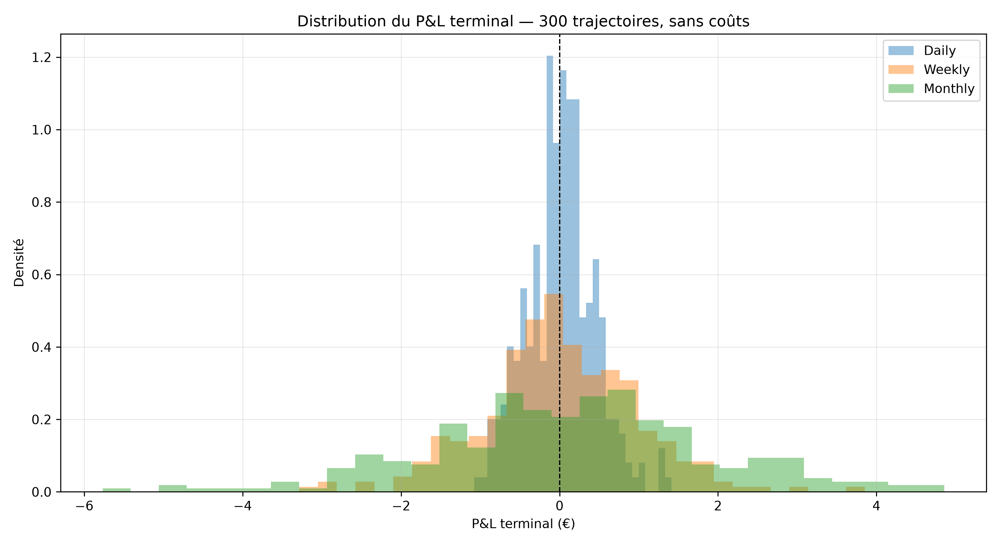

## Modèle et hypothèses

### Pricing et volatilité

Les fonctions de pricing et de volatilité implicite s'appuient sur Black-Scholes pour des options européennes, avec les conventions précisées dans le code. La volatilité implicite est obtenue par Newton-Raphson sécurisé, avec une méthode de dichotomie de sauvegarde lorsque l'itération de Newton n'est pas exploitable.

### Couverture Delta

Le moteur de couverture simule une position courte sur un Call européen, couverte par le sous-jacent et un compte espèces rémunéré au taux sans risque. La dynamique du sous-jacent est simulée par un mouvement brownien géométrique (GBM).

L'étude compare :
- trois fréquences de rebalancement : Daily, Weekly et Monthly ;
- trois niveaux de coûts de transaction : 0, 5 et 10 points de base ;
- une trajectoire commune pour comparer les stratégies dans les mêmes conditions ;
- 300 trajectoires simulées pour analyser la distribution du P&L terminal.

**Périmètre :** la partie Delta Hedging est une expérience de simulation sous mesure risque-neutre, avec taux et volatilité constants. Elle ne constitue pas un backtest historique. Les données de marché réelles sont utilisées dans la partie consacrée à la chaîne d'options AAPL.

## Installation

### 1. Cloner le dépôt

```bash
git clone https://github.com/mamethiernot099-wq/options-pricer-delta-hedging.git
cd options-pricer-delta-hedging
```

### 2. Créer un environnement virtuel

**Windows PowerShell :**

```powershell
python -m venv .venv
.venv\Scripts\Activate.ps1
```

**macOS / Linux :**

```bash
python3 -m venv .venv
source .venv/bin/activate
```

### 3. Installer les dépendances

```bash
python -m pip install --upgrade pip
pip install -r requirements.txt
```

## Exécuter le notebook

Depuis la racine du projet :

```bash
jupyter notebook notebooks/analysis.ipynb
```

Dans **Visual Studio Code** :

1. Ouvrir le dossier racine du dépôt.
2. Ouvrir `notebooks/analysis.ipynb`.
3. Sélectionner le noyau Python de l'environnement `.venv`.
4. Exécuter les cellules dans l'ordre, ou utiliser **Run All**.

La première cellule prépare les chemins du projet et le dossier `figures/`. La partie consacrée à AAPL nécessite une connexion Internet et l'accès aux données fournies par Yahoo Finance via `yfinance`.

## Lancer les tests

Depuis la racine du dépôt, avec l'environnement virtuel activé :

```bash
python -m unittest discover -s tests -v
```

Cette commande exécute les tests des modules de pricing, des Grecques, de volatilité implicite et de couverture. Le résultat affiché dans le terminal permet de vérifier le nombre de tests exécutés et leur statut.

## Limites et pistes d'amélioration

Les résultats doivent être interprétés à la lumière des hypothèses de modélisation, notamment :

- options européennes et cadre Black-Scholes ;
- taux sans risque et volatilité constants dans les simulations de couverture ;
- trajectoires GBM sans sauts ;
- rééquilibrages à dates discrètes ;
- coûts de transaction proportionnels au notionnel échangé ;
- absence de modélisation détaillée de la liquidité, du bid-ask et de contraintes de financement différenciées.

Pistes d'extension possibles :

- réaliser un backtest de couverture sur données historiques ;
- intégrer les dividendes et une structure de taux plus réaliste ;
- étudier plus finement la contribution des effets Delta, Gamma, Vega et Theta au P&L ;
- enrichir le modèle de coûts et intégrer des contraintes de liquidité.

---

**Auteur :** Mame Thierno Thiam  
**Domaine :** Finance quantitative · Mathématiques appliquées · Gestion des risques

*Projet pédagogique et quantitatif — ne constitue pas un conseil en investissement.*
